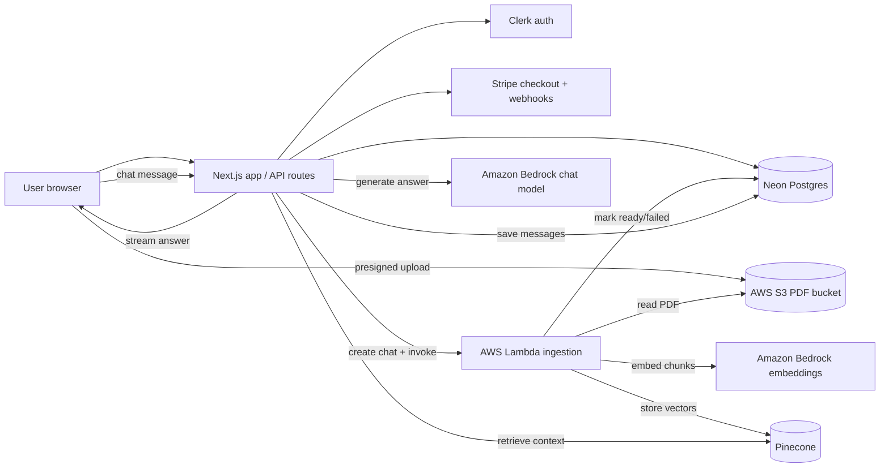

## Project Overview

This project is a web application that allows users to interact with PDF documents using chat-based features. It leverages modern web technologies and integrates with several third-party services for authentication, storage, and AI-powered functionalities.

## Features

- User authentication and authorization
- Upload and manage PDF documents
- Chat with a PDF: answers cite the page they came from, and clicking a citation jumps the viewer there
- Follow-up questions use the conversation so far
- One-click Summary, Risks and Actions for a document
- AI-powered responses with Amazon Bedrock
- Private file storage in AWS S3
- Text-based PDFs only: scanned or image-only PDFs are detected and rejected (no OCR)
- Payment processing with Stripe

## Architecture



## Technologies Used

- Next.js
- Clerk (Authentication)
- AWS S3
- Pinecone (Vector database)
- Amazon Bedrock
- Stripe (Payments)
- NeonDB

## Setup Instructions

1. Clone the repository.
2. Install dependencies with `pnpm install`.
3. Configure the environment variables listed below.
4. Create a Pinecone **serverless** index (dimension 1536 for Titan Text Embeddings v1, metric cosine) named after `PINECONE_INDEX_NAME`.
5. Apply the SQL files in `migrations/` in order, for example `psql "$DATABASE_URL" -f migrations/0000_initial_schema.sql`, then `0001`, `0002`, `0003`.
6. Run the development server with `pnpm dev`.
7. Open [http://localhost:3000](http://localhost:3000) in your browser.

## Environment Variables

To run this project, you will need to add the following environment variables to your `.env` file:

```plaintext
# Client (Public)
NEXT_PUBLIC_CLERK_PUBLISHABLE_KEY=
NEXT_PUBLIC_CLERK_SIGN_IN_URL=/sign-in
NEXT_PUBLIC_CLERK_SIGN_UP_URL=/sign-up
NEXT_PUBLIC_CLERK_AFTER_SIGN_IN_URL=/
NEXT_PUBLIC_CLERK_AFTER_SIGN_UP_URL=/
NEXT_PUBLIC_S3_BUCKET_NAME=

# Server (Private)
NEXT_BASE_URL=http://localhost:3000
DATABASE_URL=
CLERK_SECRET_KEY=
AWS_REGION=
AWS_ACCESS_KEY_ID=
AWS_SECRET_ACCESS_KEY=
AWS_SESSION_TOKEN=
S3_BUCKET_REGION=
PINECONE_API_KEY=
PINECONE_INDEX_NAME=chat-pdf-aws
BEDROCK_EMBEDDING_MODEL_ID=amazon.titan-embed-text-v1
BEDROCK_CHAT_MODEL_ID=us.amazon.nova-lite-v1:0
AWS_INGESTION_LAMBDA_NAME=
STRIPE_SECRET_KEY=
STRIPE_WEBHOOK_SECRET=
```

`S3_BUCKET_REGION` defaults to `AWS_REGION`. Leave `AWS_INGESTION_LAMBDA_NAME` empty in development to index PDFs in-process.

## Indexing and re-indexing

All indexing goes through `src/lib/document-index`. Each chat records the pipeline version that built its index (`chats.index_version`). Chats indexed by an older pipeline show "Upgrading this PDF's index…" and are rebuilt automatically the next time they are opened. When you change extraction, chunking, the embedding model or the vector metadata, bump `INDEX_VERSION` in `src/lib/document-index/internal/store.ts`.

The ingestion Lambda is built with `pnpm build:ingestion-lambda` and deployed with the Terraform in `terraform/`.
